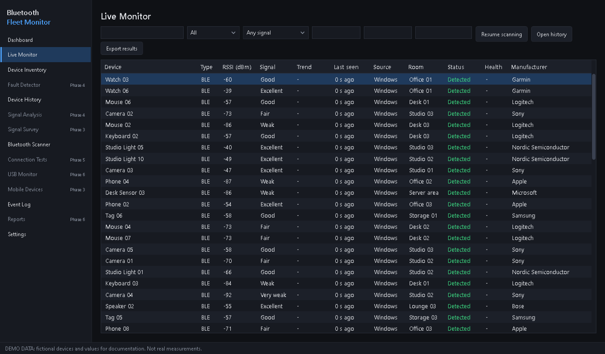
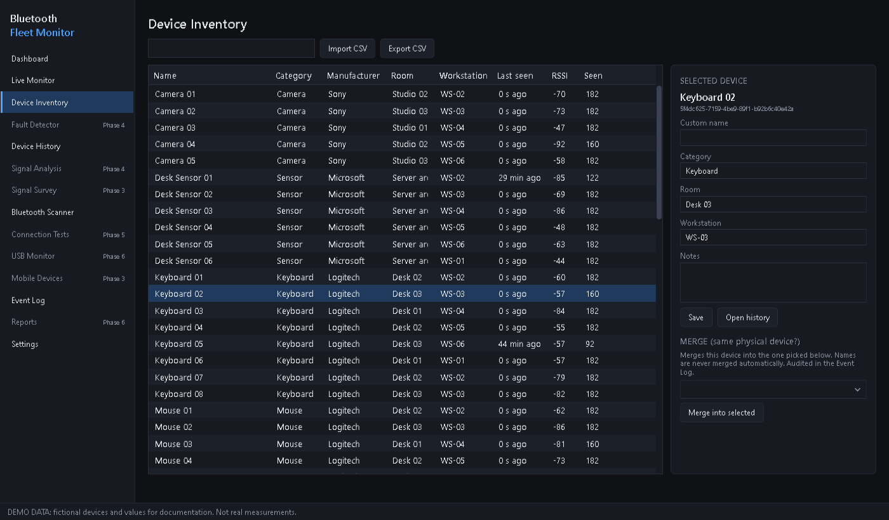
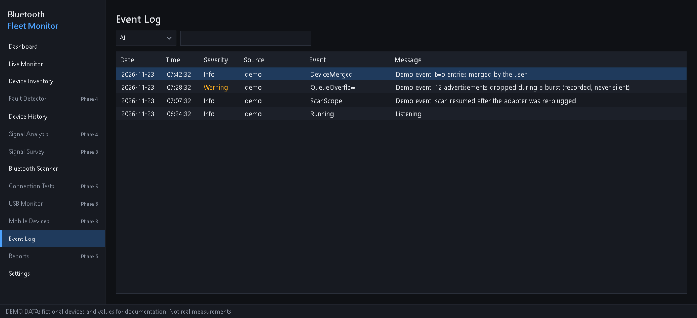
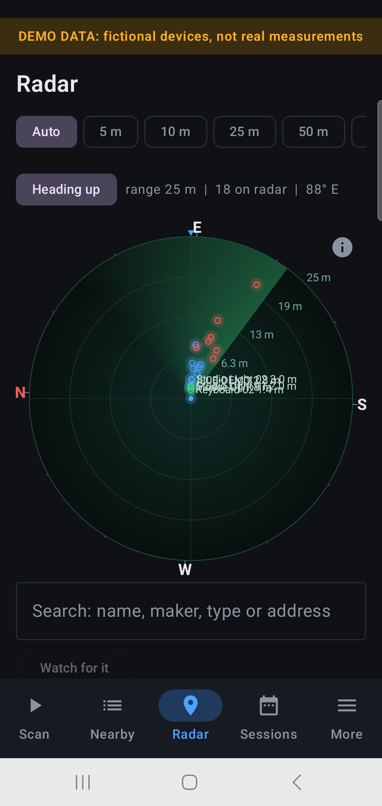
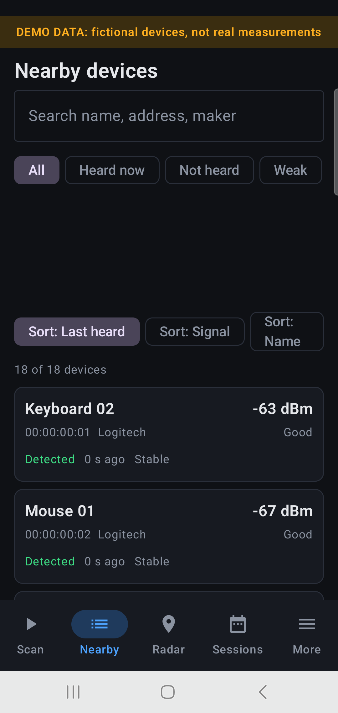
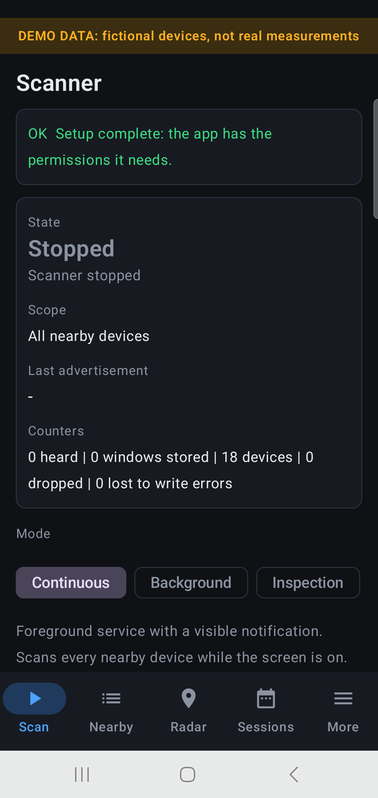

# Bluetooth Fleet Monitor

A local-only system for finding unreliable Bluetooth / BLE devices across a fleet of 170+ devices: a Windows command center that stores everything, plus a phone app that scans on the move and syncs to it over the local network. No cloud, no ads, no telemetry, no subscriptions.

> **Status: early development (Phase 2 of 6, pre-release v0.2.0).** The Windows app builds, runs, and passes 67 automated tests, and its passive BLE scanner has been verified with a real radio (1,067 advertisements from 56 devices in 30 s). The Android app builds, passes its unit tests and has scanned on a real phone (Galaxy A52s, Android 14), though not every feature is verified yet; sync and fault detection do not exist yet. See [`dist/IMPLEMENTATION_STATUS.md`](dist/IMPLEMENTATION_STATUS.md) for exactly what is and is not verified.

## Screenshots

All screenshots use **fictional demo devices** (Windows: `--demo-shots`; Android: Settings > Demo data) and are labelled "DEMO DATA" in the app. They are not real measurements.


| Live monitor | Inventory |
|---|---|
|  |  |
| **Device history** | **Event log** |
|  |  |

| Android radar | Nearby | Scanner |
|---|---|---|
|  |  |  |

## Download

Pre-release builds are on the [Releases page](https://github.com/unupunct/Bluetooth-Analizer-Best/releases). Pre-release means rough edges: see `dist/IMPLEMENTATION_STATUS.md` for what is verified.

- **Windows 10/11 (x64):** `BluetoothFleetMonitor-<version>-win-x64.exe`, a single self-contained file (no .NET install needed). It is not code-signed, so Windows SmartScreen will warn: choose "More info" > "Run anyway".
- **Android 10+:** `BluetoothFleetMonitor-<version>-android-debug.apk`. It is signed with a debug key, not a Play Store key: allow "install unknown apps" for your file manager, install, and expect Play Protect to ask. The app has no internet permission.
- Check the files against `SHA256SUMS.txt` from the same release.

## Planned components

| Component | Platform | Role |
|---|---|---|
| Command center | Windows 10 / 11 (.NET 10, WPF) | Local SQLite database, LAN API, live monitor, fault detection, history |
| Mobile scanner | Android 10+ (Kotlin, Compose) | BLE scanning, mobile inspection, offline queue, sync to Windows |
| iOS scanner | iPhone | Deferred. Needs a Mac and Xcode to build |

## What it will do

| Feature | Notes |
|---|---|
| Passive BLE scanning | Windows and Android, listen-only by default |
| Device identity | Never MAC-only (random addresses); no automatic merge on equal names |
| Fault detection (Phase 4) | Presence gaps, RSSI stability, multi-device correlation, health score 0-100 with confidence |
| Worst Offenders | Devices ranked by evidence, with the reason shown |
| Offline sync | Phone queues observations and uploads to Windows with original timestamps |
| Active connection tests | Only on a device you select, after a warning |
| USB monitor | Receiver arrival/removal events |

## Safety rules

- Absence from a scan is never reported as a confirmed disconnection.
- No proprietary commands are ever sent to devices, and existing connections are never disconnected.
- No fabricated data in production views; simulated data only in tests or a labelled Demo Mode.

## Running from source

Prepare a new machine (installs the .NET 10 SDK, JDK 17 and Android SDK 35):

```powershell
powershell -ExecutionPolicy Bypass -File .\dist\Scripts\Setup-DevEnvironment.ps1
```

Then:

```powershell
cd dist\Windows
dotnet build
dotnet test
```

## Hardware note

BLE scanning needs a Bluetooth 4.0+ adapter with the **manufacturer's driver**. On Windows 10, Realtek-based adapters (e.g. TP-Link UB500) using the generic Microsoft driver start the scanner but receive zero advertisements. Install the manufacturer driver. Windows 11 usually includes a working one.

## Documentation

- [`de-facut.txt`](de-facut.txt) - full specification (source of truth)
- [`dist/TASKS.md`](dist/TASKS.md) - phase checklist (Romanian)
- [`dist/PROJECT_PLAN.md`](dist/PROJECT_PLAN.md) - plan and environment notes

## Rezumat in romana

Sistem local de monitorizare Bluetooth pentru o flota de 170+ dispozitive: aplicatie Windows (server + baza de date) si aplicatie Android (scanner mobil). Documentatia originala in romana: [`README.ro.md`](README.ro.md).

## License

MIT - see [LICENSE](LICENSE).
