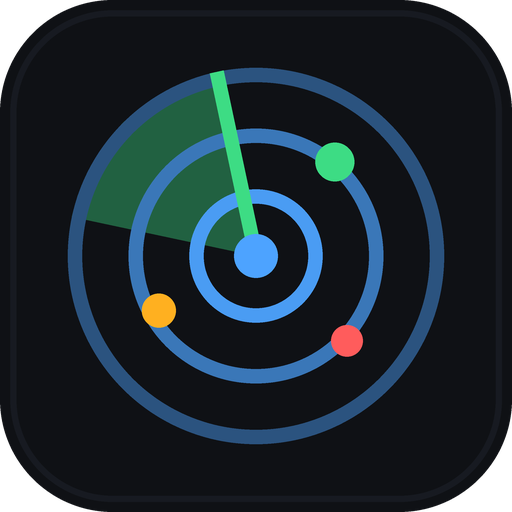
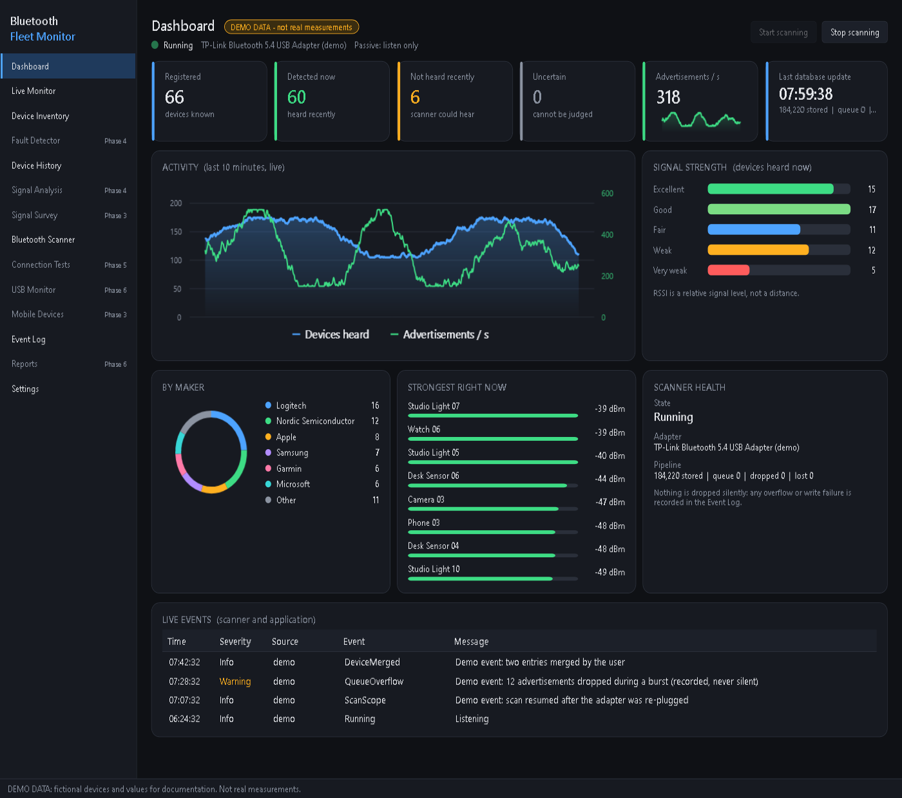
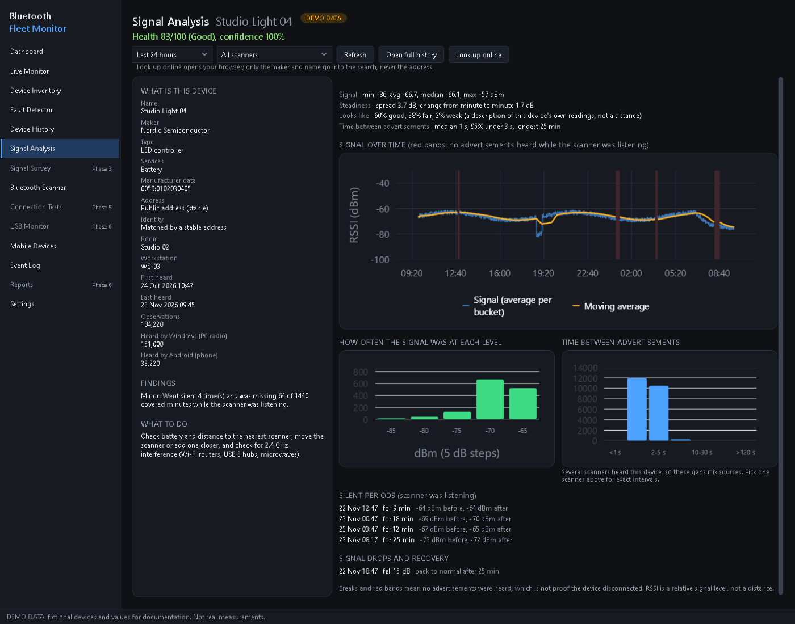
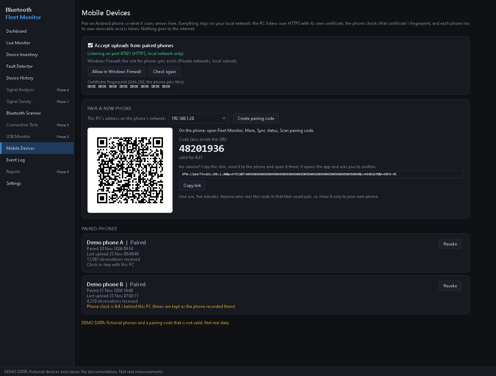
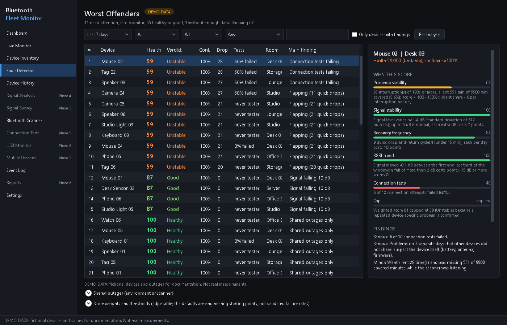
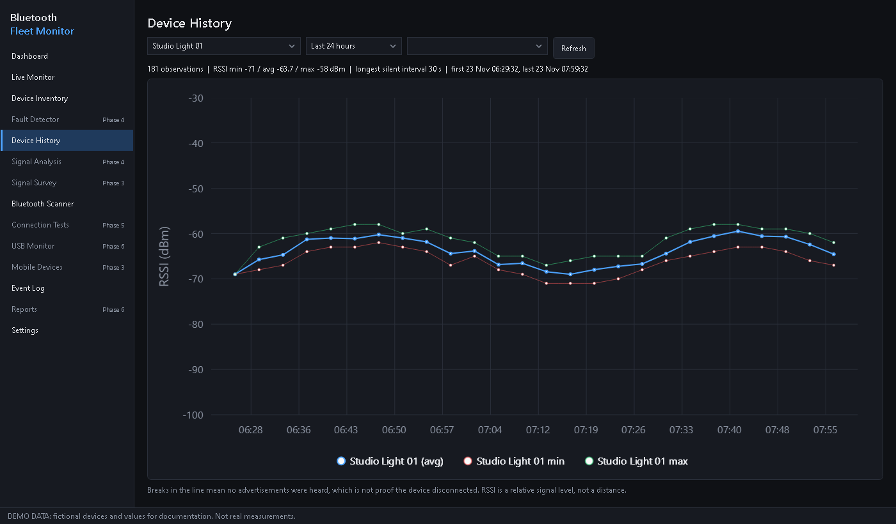

# Bluetooth Fleet Monitor

A local-only system for finding unreliable Bluetooth / BLE devices across a fleet of 170+ devices: a Windows command center that stores everything, plus a phone app that scans on the move and syncs to it over the local network. No cloud, no ads, no telemetry, no subscriptions.

> **Status: early development (Phase 3 of 6, pre-release v0.4.0).** The Windows app builds, runs, and passes 100 automated tests, and its passive BLE scanner has been verified with a real radio (1,067 advertisements from 56 devices in 30 s). The Android app builds, passes its unit tests and has scanned on a real phone (Galaxy A52s, Android 14), though not every feature is verified yet; Phone-to-Windows sync (QR pairing, HTTPS with a pinned certificate, idempotent upload) is built, unit/integration-tested, and was verified once with a real phone and real data (13,567 windows from 335 devices) through an `adb reverse` tunnel; it has not yet been run across a real Wi-Fi network with the Windows Firewall rule, which is the step you do on your own network. The Windows Fault Detector (health score, Worst Offenders) is built and unit-tested, but only exercised on fictional demo data and short real scans so far: its thresholds are engineering starting points, not validated failure rates. See [`dist/IMPLEMENTATION_STATUS.md`](dist/IMPLEMENTATION_STATUS.md) for exactly what is and is not verified.

## Screenshots

All screenshots use **fictional demo devices** (Windows: `--demo-shots`; Android: Settings > Demo data) and are labelled "DEMO DATA" in the app. They are not real measurements.



Signal Analysis: pick a flaky device and see what it is, the Fault Detector's verdict, its signal over time, how steady it is, the gaps between its advertisements and how fast it recovers (open it with the Analyse button):



Mobile Devices page: pair a phone by QR code, see paired phones, upload counts and clock differences:



Fault Detector, ranking devices by evidence and explaining every score:



| Live monitor | Inventory |
|---|---|
|  |  |
| **Device history** | **Event log** |
|  |  |

| Android radar | Nearby | Scanner |
|---|---|---|
|  |  |  |

## Download

Pre-release builds are on the [Releases page](https://github.com/unupunct/Bluetooth-Analizer-Best/releases). Pre-release means rough edges: see `dist/IMPLEMENTATION_STATUS.md` for what is verified.

- **Windows 10/11 (x64), installer:** `BluetoothFleetMonitor-<version>-Setup.exe` installs for your user without administrator rights (Start menu entry, optional desktop shortcut, uninstaller). Your data stays in `%LOCALAPPDATA%\BluetoothFleetMonitor\data` and is kept when you upgrade or uninstall.
- **Windows 10/11 (x64), portable:** `BluetoothFleetMonitor-<version>-win-x64.exe`, a single self-contained file (no .NET install needed; keeps its data in a `data` folder next to it). It is not code-signed, so Windows SmartScreen will warn: choose "More info" > "Run anyway".
- **Android 10+:** `BluetoothFleetMonitor-<version>-android.apk`: a release build (not debuggable) signed with the project's own release key, not a Play Store key. Allow "install unknown apps" for your file manager, install, and expect Play Protect to ask. Since v0.3.0 it has the `INTERNET` permission, used **only** to upload to the PC you pair (HTTPS, pinned certificate, your own network). **Upgrading from a v0.3.x APK:** those were debug-signed, and Android refuses an update signed with a different key, so the old app must be uninstalled first; that erases its local data, so pair and sync (or accept losing the stored scans) before switing. Later releases are signed with the same key and update in place.
- Check the files against `SHA256SUMS.txt` from the same release.

## Planned components

| Component | Platform | Role |
|---|---|---|
| Command center | Windows 10 / 11 (.NET 10, WPF) | Local SQLite database, LAN API, live monitor, fault detection, history |
| Mobile scanner | Android 10+ (Kotlin, Compose) | BLE scanning, mobile inspection, offline queue, sync to Windows |
| iOS scanner | iPhone | Deferred. Needs a Mac and Xcode to build |

## What it will do

| Feature | Notes |
|---|---|
| Passive BLE scanning | Windows and Android, listen-only by default |
| Device identity | Never MAC-only (random addresses); no automatic merge on equal names |
| Fault detection (Phase 4, Windows done) | Presence gaps, RSSI stability, shared-outage correlation, explainable health score 0-100 with separate confidence, adjustable weights |
| Worst Offenders | Devices ranked by evidence, with the reason shown |
| Signal Analysis | Per-device deep-dive: identity details, verdict, signal charts, silences, recovery, optional browser lookup (nothing leaves the app except the search you open) |
| Phone sync (Phase 3, built) | QR pairing, per-phone revocable token, HTTPS with a pinned self-signed certificate, batches of 500, idempotent, original timestamps kept, clock difference reported. Needs the same network and a Windows Firewall rule (the app adds it after an administrator prompt) |
| Active connection tests | Only on a device you select, after a warning |
| USB monitor | Receiver arrival/removal events |

## Safety rules

- Absence from a scan is never reported as a confirmed disconnection.
- No proprietary commands are ever sent to devices, and existing connections are never disconnected.
- No fabricated data in production views; simulated data only in tests or a labelled Demo Mode.

## Building the installer

`dist/Installer/BluetoothFleetMonitor.iss` is an [Inno Setup 6](https://jrsoftware.org/isinfo.php) script. Publish the exe (see the release flow in `CLAUDE.md`), then run `ISCC.exe /DAppVersion=<version> dist\Installer\BluetoothFleetMonitor.iss`; the setup is written to `dist\Builds\Release`. The installer is not code-signed.

## Running from source

Prepare a new machine (installs the .NET 10 SDK, JDK 17 and Android SDK 35):

```powershell
powershell -ExecutionPolicy Bypass -File .\dist\Scripts\Setup-DevEnvironment.ps1
```

Then:

```powershell
cd dist\Windows
dotnet build
dotnet test
```

## Hardware note

BLE scanning needs a Bluetooth 4.0+ adapter with the **manufacturer's driver**. On Windows 10, Realtek-based adapters (e.g. TP-Link UB500) using the generic Microsoft driver start the scanner but receive zero advertisements. Install the manufacturer driver. Windows 11 usually includes a working one.

## Documentation

- [`de-facut.txt`](de-facut.txt) - full specification (source of truth)
- [`dist/TASKS.md`](dist/TASKS.md) - phase checklist (Romanian)
- [`dist/PROJECT_PLAN.md`](dist/PROJECT_PLAN.md) - plan and environment notes

## Rezumat in romana

Sistem local de monitorizare Bluetooth pentru o flota de 170+ dispozitive: aplicatie Windows (server + baza de date) si aplicatie Android (scanner mobil). Documentatia originala in romana: [`README.ro.md`](README.ro.md).

## License

MIT - see [LICENSE](LICENSE).
